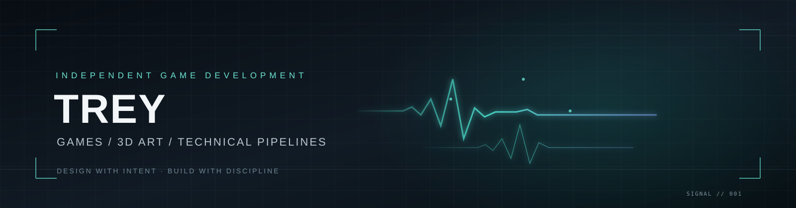

<!-- Profile banner -->

  

<h1 align="center">Hey, I'm Trey.</h1>

  <strong>Indie Game Developer · 3D Art · Technical Art · AI-Assisted Production</strong>

  I build original game experiences and the production systems behind them — from 3D assets and animation workflows to playable prototypes and reusable development pipelines.

---

## Currently building

### DEAD SIGNAL
*A grounded reconnaissance mission becomes the first thread in a much larger signal mystery.*

A single-player, near-future tactical action-shooter vertical slice focused on stealth, tactical encounters, responsive action and a gradual science-fiction reveal.

- **Gameplay:** stealth, observation, tactical choices and direct action.
- **World:** compact, carefully authored environments instead of an oversized first milestone.
- **Visual direction:** grounded military forms, gritty stylized realism and restrained sci-fi accents.
- **Production goal:** a polished playable slice supported by a reusable art and development pipeline.

> DEAD SIGNAL is currently in private pre-production while the core concept and production foundation are being developed.

## What I work on

| Area | Focus |
| --- | --- |
| Game development | Small playable slices, combat systems and cross-engine workflows |
| 3D & technical art | Blender modelling, rigs, animation and engine-ready assets |
| Production pipelines | Reusable workflows, asset validation, documentation and build checks |
| AI-assisted development | Human-directed collaboration, shared context, scoped tasks and code review |

## Tools in my workflow

- **Engines:** Unity · Godot
- **3D & 2D art:** Blender · Krita
- **Development:** Git · GitHub · VS Code
- **AI collaborators:** Claude Desktop · Codex · Cursor · Antigravity

## How I build

- Start with a clear brief and a small, testable milestone.
- Use AI to accelerate exploration and implementation, not replace design judgement.
- Keep project context documented and portable across tools.
- Review generated work, run tests and verify builds before calling a task complete.
- Prefer maintainable systems and intentional art direction over unnecessary complexity.

---

  Building deliberately. Learning in public. Shipping one strong slice at a time.

